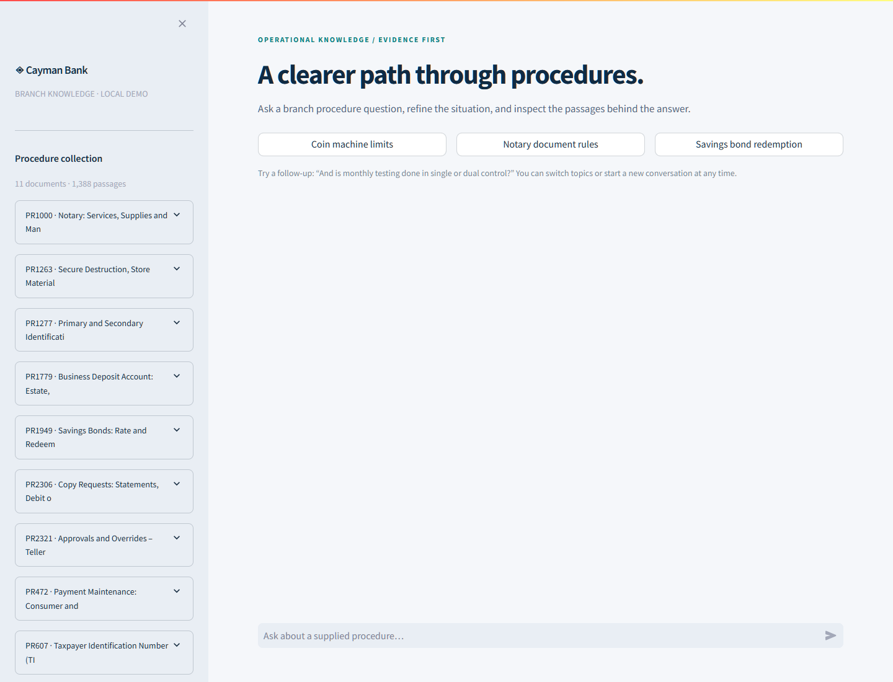

# Branch Assist · Cayman Bank Procedure Assistant

A local generative conversational assistant, evaluation suite and six-slide solution presentation over eleven operational procedures. Start with [the detailed solution overview](SOLUTION_OVERVIEW.md) and [the requirement traceability review](docs/ASSIGNMENT_REVIEW.md).

Version 2 adds a Wells Fargo–inspired workspace with a procedure library and an evidence desk. Inspect exact source passages, statement-to-source checks and actual execution activity; a failed draft can receive one bounded correction before being withheld. Read [the version 2 design](docs/EXPERIENCE_V2.md) for the architecture and limitations. The knowledge collection is limited to the provided Cayman Bank documents.



Watch the approved **[silent, tool-only demo](demo/final/Watch_Final_Demo.html)**, or play [its MP4](demo/final/Branch_Assist_Final_Approved.mp4) directly: **9:25, 1440p, 25 actual UI scenes, large plain-language descriptions at the bottom, focused zooms and unhurried reading holds, with no audio track**. The readable edition uses fresh, double-density lossless browser capture and normal-speed interactions. It covers questions, citations, checks/activity, follow-ups, procedure search/scope, review, exports, safe outcomes and evaluation. The [scene guide](demo/final/SCENE_GUIDE.md) and [production details](docs/VIDEO_PRODUCTION.md) document the edit and verification. The [earlier narrated version](demo/Watch_Demo.html) remains available separately.

For reliable chapter seeking in a browser, run `python scripts/serve_demo_video.py` and open **http://127.0.0.1:8502/final/Watch_Final_Demo.html**. This serves only the demo folder on localhost and supports MP4 byte ranges. The standalone MP4 also works directly in a media player.

The project is saved in the private repository [suyog957/cayman-procedure-assistant](https://github.com/suyog957/cayman-procedure-assistant). It includes the supplied documents, prepared index, evaluation evidence and presentation materials. Downloaded model weights, environments, secrets and local caches are excluded; the pinned downloader recreates the models.

```powershell
git clone https://github.com/suyog957/cayman-procedure-assistant.git
cd cayman-procedure-assistant
```

The approved final video and its supporting files are preserved separately in `demo/final/`. `APPROVED_FINAL.json` records their hashes; build scripts do not write to this directory. See [the end-to-end final review](docs/FINAL_REVIEW.md) for assignment coverage, fixes, checks and the recording decision.

## Run the prepared demonstration

From `D:\Projects\WF`:

```powershell
python -m streamlit run app.py
```

Open **http://127.0.0.1:8501**. The model weights and prepared index are already present in this workspace. No API key is needed. The server binds to this computer only. The first question loads local models; later questions reuse them. Use the source panels to inspect the supplied evidence. CPU generation takes longer than retrieval.

Try these in one conversation:

1. “What is the overnight storage limit for a coin-counting machine?”
2. “And is monthly testing done in single or dual control?”
3. “What about savings bond redemption fees?”

See [the solution walkthrough](docs/SOLUTION_WALKTHROUGH.md) for the full presentation sequence, expected source facts and fallback procedure.

## Presentation and submission

The **[six-slide solution PowerPoint](submission/Branch_Assist_Solution_Presentation_Final.pptx)** and [matching PDF](submission/Branch_Assist_Solution_Presentation_Final.pdf) present the objective and implemented scope, document engineering, architecture and technology choices, user experience and follow-ups, evaluation, and demonstration. Opening slides explain the solution and its methodology; examples are confined to the experience and demonstration sections. See [the slide preview](artifacts/presentation/Leadership_Deck_Preview.jpg) and [the presentation content map](docs/PRESENTATION_STORY.md).

The same folder contains presenter notes, the timed demo runbook and recorded demonstration responses. `submission/Presentation_Materials.zip` contains the current allowlisted presentation artifacts and excludes implementation source, model files and raw evaluation internals. The approved final video remains separate and unchanged.

The shared presentation package excludes implementation source and model files. Use the solution walkthrough for the presentation flow, procedure questions and source facts to inspect.

## Reproduce on another Windows machine

Tested locally with Python 3.10.2, Windows x64, a 16 GB Intel CPU laptop, and no CUDA GPU. Allow several GB for models and dependencies. The model downloader uses public Hugging Face model files; inference uses local files. Model downloads require internet access once.

```powershell
python -m venv .venv
.\.venv\Scripts\python.exe -m pip install -e ".[dev]"
.\.venv\Scripts\python.exe scripts/download_models.py
.\.venv\Scripts\python.exe scripts/build_index.py
.\.venv\Scripts\python.exe -m pytest -q
.\.venv\Scripts\python.exe -m streamlit run app.py
```

The quantized model uses `llama-cpp-python`. If a compatible Windows wheel is unavailable from your configured package index, the project's documented CPU wheel index is `https://abetlen.github.io/llama-cpp-python/whl/cpu`. A source build requires a C++ toolchain; the tested environment used a prebuilt wheel.

## Validation and artifact commands

```powershell
python -m pytest -q
python scripts/evaluate.py --generate
python scripts/audit_artifacts.py
python scripts/build_deliverables.py
```

`evaluate.py` without `--generate` runs retrieval ablations only. Every run writes to a new isolated directory under `artifacts/experiments/`, printed at startup, so partial or retrieval-only runs cannot overwrite the accepted presentation results. Use `--output-dir` for a new/empty custom run directory. A completed full Qwen3 run can replace the accepted results with `python scripts/evaluate.py --generate --publish`; rebuild and recheck the presentation afterward. Existing accepted responses and metrics remain at `artifacts/evaluation/answer_details.json` and `metrics.json`. Cases and expected fact groups are in `evaluation/cases.json`.

For a terminal conversation:

```powershell
python scripts/ask.py "What is the coin-counting machine overnight limit?" "And what control is required for monthly testing?"
```

`scripts/check_browser.py --chat` is an optional browser integration check using Playwright and installed Chrome. It verifies citations, check/activity views, the procedure library, export and session behavior. It is a development check, not a runtime dependency. Start the local Streamlit server first. Screenshots and browser results are stored under `artifacts/`.

After the full browser check and a test run with `--junitxml=artifacts/test_results.xml`, `python scripts/verify_deliverables.py` checks source integrity, index dimensions, slide count, notes, evaluation consistency and the source-free archive. The prepared workspace includes these verification artifacts. Rebuilding uses desktop PowerPoint when available, with local LibreOffice Impress as an independent rendering option. Both produce the PDF and visual previews from the editable PPTX. Install the preparation extras with `python -m pip install -e ".[dev,presentation]"`; the app itself does not require PowerPoint. Run `python scripts/verify_presentation.py` after rebuilding to check assignment coverage, metric labels, editability and PDF consistency.

## Project map

| Location | Contents |
|---|---|
| Original PDF and `Cayman_Bank_HTML_Files 2/` | Untouched assignment and eleven source procedures |
| `src/cayman_assistant/` | Structural ingestion, hybrid retrieval, generation, conversation handling and output checks |
| `app.py`, `interface.py`, `experience.py`, `assets/` | Branded workspace, evidence desk, source library, activity records and safe rendering |
| `evaluation/` | Source-checked regression cases, independent-review rubric and blank human-review template |
| `tests/` | Focused tests for parsing, provenance, conversation behavior and safeguards |
| `docs/` | Requirements, architecture, AI-use disclosure, detailed walkthrough and timed demo |
| `artifacts/index/` | Passage store, source manifests, vectors and normalized procedure extracts |
| `artifacts/evaluation/` | Measured results and raw answer traces |
| `artifacts/experiments/` | Earlier diagnostic runs, clearly separate from final results |
| `artifacts/runtime_manifest.json` | Exact package versions, model revisions and file hashes |
| `submission/` | Presentation materials only; no implementation source |

## Interpretation of results

The implementation uses a fixed provided document collection. A retrieved citation is not a guarantee of a correct answer. Automatic fact matching and the NLI screen can be wrong. Cases are AI-authored and source-checked, not independently SME-labelled. The evaluation report states observed failures, coverage, fallback behavior and the need for independent review. Enterprise authentication, document entitlements, current-policy authority, production monitoring and approval have not been implemented.

Read [the architecture](docs/ARCHITECTURE.md), [AI use and validation](docs/AI_USE_AND_VALIDATION.md), and [the review rubric](evaluation/REVIEW_RUBRIC.md) before presenting the results.
