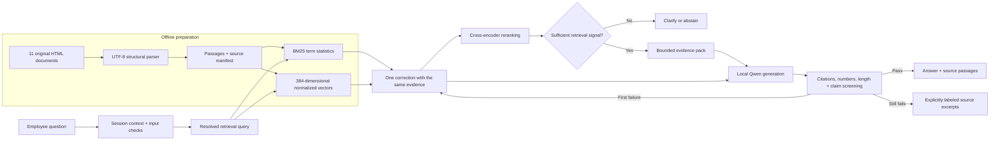

# Architecture and engineering decisions

Current pipeline: **version 2.0**. See [the version 2 experience and grounding design](EXPERIENCE_V2.md) for the evidence desk, observable execution events, citation-local checks, source-snapshot revalidation and one bounded correction. The supplied procedural corpus and local inference boundary remain the same.

The assistant retrieves evidence from the supplied procedure snapshot, generates a concise answer locally, and exposes the supporting passages. The architecture separates data processing, retrieval, conversation handling, generation, checks and presentation so that each stage can be tested and replaced independently.

## Data flow

## Components and their responsibilities

| Component | Choice | Reason and tradeoff |
|---|---|---|
| Interface | Streamlit, bound to localhost | Rapid conversational UX with session state and source panels; appropriate for a single-machine exercise, not an enterprise identity boundary |
| Parsing | BeautifulSoup over explicit UTF-8 | The supplied files are HTML exports with meaningful CSS classes; rendering or OCR would lose useful structure and add dependencies |
| Passage store | JSONL records plus a source manifest | Inspectable, deterministic and portable; avoids unsafe serialized Python object loading |
| Lexical search | BM25, k1=1.5, b=0.75 | Exact procedure identifiers, transaction codes, amounts, and specialized terms matter in this corpus |
| Semantic search | all-MiniLM-L6-v2, normalized 384-dimensional vectors | Finds paraphrases; small enough for local CPU use; domain performance must be measured |
| Fusion | Reciprocal rank fusion, constant 60 | Combines rankings without treating BM25 and cosine scores as directly comparable |
| Reranking | ms-marco-MiniLM-L6-v2 | Scores a question and candidate passage jointly; improves first-result ordering at extra CPU cost |
| Generation | Qwen3-4B, official Q4_K_M GGUF through llama.cpp, CPU, greedy decoding | Actual local generative model, no API key or runtime remote model calls; quantization fits a stronger model on the available laptop |
| Claim screening | nli-deberta-v3-small | Additional signal for unsupported or contradictory statements; imperfect on banking language and not a factual guarantee |
| Tests and measurement | pytest plus reproducible evaluation scripts | Tests mechanics separately from empirical answer quality and retains raw outputs |

These models were chosen for a reproducible local demonstration on the available laptop. Their model-card benchmarks are not evidence of performance on this assignment. Results in `artifacts/evaluation/metrics.json` are measured on this corpus.

## Why retrieval-augmented generation

Operational procedures need explicit provenance and replacement when documents change. Fine-tuning is a poor first choice for injecting eleven frequently revised procedural sources: it does not itself provide traceable citations or reliable deletion/version control. Sending every document with every question would waste context, increase latency, and distract the generator with unrelated rules. A search-only system is useful as a baseline and fallback but does not satisfy the requested generative conversational experience.

The runtime model is deliberately grounded in retrieved passages rather than its general training knowledge. That instruction can still fail, which is why the implementation checks outputs and reports coverage and failure cases.

## Document processing and organization

The corpus has eleven documents and 139 HTML tables, including nested tables. PR1779 is much larger than the other procedures. The parser recognizes the exported `PolicyTitle`, `PublishDate`, major-section and subsection classes, not only native HTML heading tags.

Each passage stores the document ID and title, publication text, relative source filename, SHA256 of the original source, section hierarchy, source anchor, passage ordinal, text, content kind, and table/row location where applicable. The passage ID derives from the source hash, ordinal, and text. This makes IDs stable across an identical rebuild and intentionally changes them after a source revision.

Scripts, styles, frames and display-only headers/footers are excluded. External links are never fetched. Some input links point to placeholder destinations; neither their destination nor linked policy contents are treated as evidence. Source files are decoded as UTF-8 explicitly, which avoids punctuation corruption caused by Windows code-page guesses. Unicode compatibility normalization is applied to extracted text; the source bytes and source hash remain unchanged.

Narrative content is grouped within a section to a target of 110 whitespace words. Long blocks are split near sentence boundaries with 20-word overlap. Table rows repeat column labels, carry rowspan conditions, account for colspans, and flatten nested table contents once. Oversized rows are split to roughly 110 words and repeat up to 300 characters of the leftmost row condition. Unsplit table rows can reach 130 words; a repeated condition makes a continuation longer. This is a word-based target, not an exact tokenizer bound. The generator also enforces a token budget.

The initial 180-word grouping diluted specific rules and encouraged unrelated context. Shorter passages were selected after observing those development failures. No claim is made that this is globally optimal. A production parser should represent table cells and branching logic as typed structures and have SME-approved extraction coverage tests.

The index contains a JSONL passage store, a JSON source manifest, normalized Markdown extracts and an unpickled NumPy embedding matrix. The embedding manifest binds the matrix to the exact passage-file hash. At startup, original source hashes and the passage/embedding relationship are checked. Every supported request also checks the source files and cached-index fingerprints; changed input requires a rebuild. This detects stale local input, not malicious tampering with every artifact at once. Signed manifests and trusted artifact storage are production improvements.

## Retrieval sequence

1. Normalize lexical terms, retaining negations and numbers. Expand a small set of common abbreviations such as TIN and SSN. This is lexical matching, not entity-specific policy logic.
2. Retrieve up to 30 BM25 candidates and up to 30 dense candidates. Dense query encoding uses the same model and normalization as indexing. Exact matrix search is adequate for this small corpus.
3. Fuse candidate rankings with RRF and retain up to 30 candidates for reranking.
4. Cross-encode the resolved question and each candidate. Return ranked hits with raw BM25, cosine and reranker signals.
5. If retrieval support is too weak, abstain. Initial development thresholds are cosine >=0.24 and reranker logit >=-2.0 on the top hit. These are uncalibrated heuristics, not probabilities or safety guarantees.
6. Build an evidence pack of up to three nonduplicate passages and 520 words. Secondary hits must be within 1.5 reranker points of the top hit and above -2.0. Preserve the complete selected passage instead of cutting off a trailing exception to meet the word target. A single oversized passage is permitted within the hard prompt-token budget.

Before packing, the leading two hits can expand to their immediately following same-section qualification or continuation of the same table row. Expanded passages record their originating hit and inherit its retrieval signals; these signals are not new independent relevance scores. This repairs a common split-boundary problem, including exceptions separated from their general rule.

Narrowing the evidence pack reduces distracting situations but can omit a required exception elsewhere in the document. The evaluation therefore distinguishes evidence retrieval, evidence packing, answer completeness and refusal/fallback behavior. A production version should detect cross-references and expand conditions more comprehensively, with regression tests.

## Conversation handling

Each browser session owns its messages, last questions, topic references and feedback. The cached model/index objects are shared read-only; user histories are not. Generation uses a lock to prevent simultaneous use of the CPU model.

Explicit procedure IDs take priority. Named topics are recognized using a small, readable list of procedure-domain cues. A named new topic starts a new retrieval query. Elliptical questions and pronouns can carry forward the previous question and its procedure scope. The app passes at most four recent turns, and query context is length-bounded. Previous generated text is never fed back as authoritative evidence. Follow-ups perform fresh retrieval.

This deterministic resolver is transparent and cheap, but it is intentionally limited. Subtle topic changes, ambiguous entities, and long conversations can be misresolved. The UI has a reset control and asks for clarification when a short/pronominal question arrives without usable context. Unsupported/refused topics clear the UI's topic history.

## Generation and output handling

The local Qwen3 model receives a fixed system prompt, a clearly delimited evidence block with source labels, and the resolved question. It is instructed to answer the exact fact first, preserve conditions and exceptions, distinguish mandatory requirements from recommendations, use only supplied evidence, remain concise, and cite each factual paragraph. Qwen3 non-thinking mode is used for the bounded answer task. Greedy decoding is used for repeatability. The hard budget is 3,800 input tokens and 240 generated tokens. Greedy decoding does not remove hallucinations. An explicit insufficient-evidence marker produces an abstention instead of a fabricated answer.

An initial Qwen2.5 1.5B float32 baseline and a Qwen3 comparison are retained in `artifacts/experiments/`. The initial model comparison favored the quantized generator. Version 2 adds support checks and a bounded correction that can increase end-to-end CPU latency; use the current measured results rather than treating model size as a speed guarantee. The system remains limited and has not been validated by independent SMEs. Model repository revisions and exact local file hashes are recorded; the default downloader pins those revisions.

Mechanical checks reject absent or unknown source labels, uncited substantive paragraphs, invented numeric literals and excessive answer length. Numeric comparison canonicalizes equivalent decimal/currency forms such as 36 and 36.00. Claims are split into sentences and neutral attribution phrases are removed. Substantive verbatim matches to a cited passage have a direct textual-support check; paraphrases use the NLI model, including adjacent sentence windows to reduce long-premise dilution. The initial NLI threshold is entailment >=0.55 and contradiction <0.20. All claims must pass. Verbatim matching does not establish applicability to the user's situation. The classifier is trained on general NLI datasets and can both reject valid banking answers and miss unsupported claims. Neither is independent ground truth.

When validation still fails after at most one correction, the response explicitly says the generated answer could not be validated and shows retrieved source excerpts. This is reported as `evidence_only`, not as a successful generated answer. A generated answer that says information is absent is tagged `partial` when detected by simple language rules. Every factual response includes its evidence objects, model identity, checks, timings and trace ID for inspection. The app does not show a fabricated confidence percentage.

The mechanical checker also rejects recognizable changes between strict and inclusive boundaries for the same numeric value, such as changing “less than $2 million” into “$2 million or less.” This comparator check covers selected language patterns, not general mathematical verification.

## Controls that exist in the prototype

- No source-link crawling or execution of HTML scripts.
- Local-only model loading during inference, `trust_remote_code=False` for transformer components, safetensors encoder/classifier files and an official GGUF generator file.
- Source change detection and index consistency validation.
- Direct instruction-injection pattern checks and bounded input lengths.
- A few obvious customer identifier patterns trigger a request to rephrase. This is not comprehensive PII detection.
- Source passages treated as reference data, not instructions.
- Source labels, numeric checks, and NLI screening; explicit fallback or abstention.
- No transaction tools or write access to banking systems.
- Browser-session memory, opt-in transcript download, in-session feedback, and no automatic persistent chat logging.
- Streamlit telemetry disabled and server bound to 127.0.0.1.

Input patterns and prompt instructions do not solve prompt injection. Publication dates do not establish that a document is currently authoritative. None of these controls replaces employee judgment, SME review or enterprise security controls.

## Production path and ownership

| Area | Work before a real pilot | Owner |
|---|---|---|
| Corpus authority | Approved source ingestion, effective/expiry dates, supersession rules, signed versioned releases and rollback | Procedure owners + platform engineering |
| Access control | SSO, document-level entitlements before retrieval, session security | Identity/security engineering |
| Generation | Compare stronger approved hosted/private models on the same blinded test set; assess latency and cost | AI engineering + model risk |
| Quality | Independent SME labels, risk-weighted pass criteria, unseen procedures/scenarios, contradiction and stale-policy tests | Operations SMEs + validation |
| Operational safeguards | Rate limits, concurrency controls, timeouts, audit/redaction/retention, monitoring and incident response | Platform + security + operations |
| Business outcomes | Measure time to find correct guidance, task success, employee trust and escalation quality against current search | Product + branch operations |
| Controlled rollout | Shadow mode, limited roles/topics, human escalation, rollback and documented go/no-go | Business sponsor + governance |

Do not infer production readiness from the small regression set. A pilot decision should require no critical unsupported instructions on an independently reviewed test suite, explicit review of abstentions and exclusions, acceptable task completion time, and approvals from the relevant enterprise owners. Numeric release targets in the evaluation rubric are proposals, not achieved service levels.

## Primary technical references

- [Qwen3-4B model card](https://huggingface.co/Qwen/Qwen3-4B) and [official GGUF distribution](https://huggingface.co/Qwen/Qwen3-4B-GGUF): selected model, quantized artifact and non-thinking operation; verify license suitability separately for deployment.
- [llama-cpp-python](https://github.com/abetlen/llama-cpp-python): local CPU inference bindings and prebuilt wheel installation.
- [all-MiniLM-L6-v2 model card](https://huggingface.co/sentence-transformers/all-MiniLM-L6-v2): sentence representation model and vector dimensionality.
- [Sentence Transformers retrieval and reranking documentation](https://www.sbert.net/examples/sentence_transformer/applications/retrieve_rerank/README.html): bi-encoder retrieval followed by joint query/passage scoring.
- [ms-marco-MiniLM-L6-v2 model card](https://huggingface.co/cross-encoder/ms-marco-MiniLM-L6-v2): selected passage reranker.
- [nli-deberta-v3-small model card](https://huggingface.co/cross-encoder/nli-deberta-v3-small): contradiction, entailment and neutral label ordering and training scope.

These references support component descriptions, not the measured claims about this prototype.
