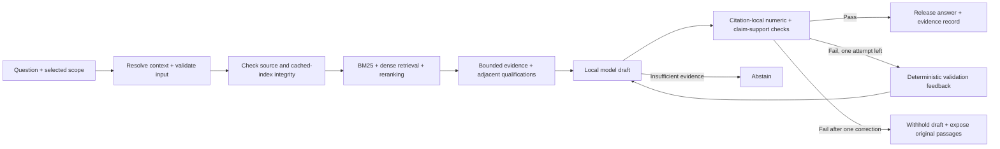

# Branch Assist: experience and grounding architecture, version 2

The second iteration makes the existing local solution easier to use and inspect. It introduces a Wells Fargo–inspired visual language, an evidence workspace and observable execution records, while retaining the eleven supplied Cayman Bank procedures as the only knowledge source. It is clearly labelled as an interview prototype rather than a Wells Fargo product.

## Experience decisions

The interface uses the unmodified white wordmark from the official website, a red header with a gold rule, warm neutral surfaces and a serif headline paired with system sans-serif body text. Brand provenance is recorded in `assets/brand/PROVENANCE.md`. No proprietary font files are bundled and no sign-on or transaction interface is reproduced.

The previous collection of long sidebar accordions is replaced with three purposeful views:

- **Workspace:** a conversation and an evidence desk. The desk follows a selected answer and does not silently reuse a previous answer's evidence for a new unsupported question.
- **Procedure library:** search by topic, document name or identifier; inspect publication and source identity; download the original; restrict the workspace to that procedure.
- **Evaluation:** inspect recorded retrieval and answer metrics with their limitations, and download the reports and presentation.

The source scope is an actual retrieval restriction. A question naming a conflicting procedure asks the user to change scope rather than answering from the wrong document. New-investigation, contextual suggestions, recent-answer selection, feedback and export remain session-scoped. A suggested question is curated navigation, not a canned answer or a claim that the model generated the suggestion.

## Evidence desk

The **Evidence** view shows the exact indexed passage, source identifier, section, publication text, table location where relevant, current source-hash verification, original-file download, and optional retrieval signals. Every answer's citation buttons select a passage belonging to that specific trace. Source text is escaped and never executed as HTML. Ranking scores are not presented as calibrated confidence.

The **Checks** view shows the checks actually run: source labels, claim attribution, numeric literals, recognized numeric boundaries and claim support. Not-run checks remain explicitly not run. Each screened claim has its associated citation, supporting passage identity, selected evidence window and support method (verbatim match or NLI). Withheld-draft claims are labelled accordingly. A passed screen is not represented as independently established truth.

The **Activity** view contains factual runtime events: context resolution, snapshot verification, retrieval, evidence assembly, drafting, validation, an optional correction, and the release/withhold decision. Events contain actual elapsed times and counts. The decision summary is assembled deterministically from observed checks. It is not a generated explanation of the model's private reasoning or a simulated chain of thought.

## Backend changes that make the experience real

1. **Fresh integrity checks.** A cached retriever fingerprints the source manifest, passage store, embedding manifest and vector-matrix file. Startup also checks the matrix hash, dimensions, finite values and normalization. Every supported request checks the fingerprints and original sources. A rebuild invalidates a cached engine rather than allowing stale in-memory passages to answer against newer files. The evidence desk also verifies the selected cited file's current bytes before showing a matching-source badge.
2. **Claim-local citations.** Explicit sentence citations bind to their own sentences; they are not shared across all claims in a paragraph. A single paragraph footer can still cover that paragraph, as the generation contract permits. Numbers and recognized boundaries are checked against the cited passage set for that claim, not against arbitrary uncited passages elsewhere in the context.
3. **Inspectable support.** The verifier records the supporting label, passage ID and evidence window used for its decision. Verbatim text can demonstrate a direct textual match; NLI supplies a fallible paraphrase screen. Neither establishes that a quoted action applies to the user's situation.
4. **One bounded correction.** A failed draft can be regenerated once using the same evidence and deterministic failed-check feedback. Retrieval is not broadened and no new evidence is fabricated. The revised draft must pass the same checks. Further failure yields a labelled source-only outcome; an insufficient-evidence marker yields abstention. The trace reports a correction only when it happened.
5. **Observable orchestration.** The engine accepts an optional progress callback and also returns a serializable activity record. The UI displays real actions as they complete, then exposes the durable record. Model setup is separately labelled while the local models load.

The bounded workflow is deliberately a single orchestrator with read-only retrieval and model calls. It does not pretend to run a team of autonomous agents or execute bank transactions. An agent framework would add machinery without improving the present task's evidence boundary.

## Engineering boundaries

`app.py` manages session lifecycle and model caching. `interface.py` implements the views; `experience.py` owns escaped presentation helpers and source-badge checks; `assets/workspace.css` owns the visual system. Backend orchestration remains in `assistant.py`, mechanical checks in `validation.py`, support screening in `verification.py`, and factual execution records in `observability.py`.

Previous evaluation results are preserved in `artifacts/experiments/v1_complete_before_workspace_v2`. The full regression suite is rerun for version 2, and current metrics carry the pipeline version. This is an end-to-end iteration comparison, not an isolated causal claim about any one change. Presentation figures and reports are regenerated from the completed current run.

## Validation

The automated suite adds regressions for local citation binding, post-period citations, paragraph footers, numeric borrowing from an uncited passage, wrong-source verbatim matches, selected evidence quotes, one-correction release and exhaustion, no fictitious correction on a passing first draft, conflicting document scope, changed cached sources/indexes, escaped source markup and previous-source isolation.

Browser checks exercise actual local generation, follow-ups, citation selection, source inspection, claim checks, the activity record, procedure search/scope, feedback, complete transcript export, separate sessions, reset and a narrow viewport. Screenshots are retained for visual review.

The existing limitations remain: AI-authored regression labels, imperfect NLI and numeric pattern checks, incomplete policy-version authority, ambiguous conversations, and no enterprise identity, entitlements or production approval. A more inspectable interface is not evidence of greater factual accuracy; quality changes are measured separately.
